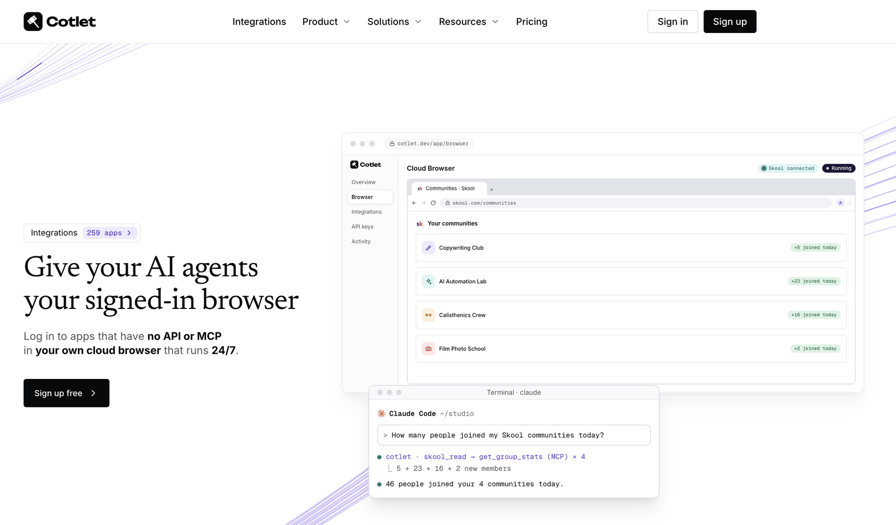

<div align="center">

<a href="https://cotlet.dev">
  <picture>
    <source media="(prefers-color-scheme: dark)" srcset="assets/logo-white.svg">
    
  </picture>
</a>

### Give your AI agents your signed-in browser.

Log in to apps that have no API or MCP in your own cloud browser that runs 24/7.
Your agent works in them over one MCP server. A REST API too.

[Website](https://cotlet.dev) ·
[Integrations](https://cotlet.dev/integrations) ·
[Docs](https://cotlet.dev/docs) ·
[MCP server](https://cotlet.dev/docs/mcp) ·
[REST API](https://cotlet.dev/docs/api) ·
[Pricing](https://cotlet.dev/pricing) ·
[Security](https://cotlet.dev/security) ·
[Sign up free](https://cotlet.dev/signup) ·
[X](https://x.com/cotletdev)

[](https://cotlet.dev)
[](https://cotlet.dev/docs/mcp)
[](https://cotlet.dev/docs/api)
[](https://cotlet.dev/integrations)
[](https://cotlet.dev/llms.txt)
[](https://x.com/cotletdev)

<a href="https://cotlet.dev"></a>

</div>

---

## What is Cotlet?

**Cotlet** gives your AI agent your signed-in browser. You get **your own Chrome in the cloud**, the Cloud Browser. Sign in there **yourself, once**, to the apps that have **no official API** or only a narrow one, enable them for your agents, and your agent works **in your own account** 24/7, even when your computer is off: it moves bookings, sends invoices, approves members, pulls reports, relists items. Cotlet never saves your password, and every background request is listed.

Your agent reaches the signed-in apps three ways:

- as tools in **one remote MCP server** (`https://cotlet.dev/mcp/v1`) for ChatGPT, Claude, Cursor and other AI agents;
- as a **REST API** (`https://cotlet.dev/api/v1`) for your own scripts and cron jobs;
- by **driving the Cloud Browser itself**, with browser tools over MCP or over Chrome DevTools, when no tool does the job.

Cotlet builds, tests and maintains the tools for every app in the catalog.

> **In one sentence:** Cotlet is a hosted MCP server and REST API that lets AI agents work in apps with no API, in a cloud browser you signed in to.

| | |
|---|---|
| **Product** | Your own Cloud Browser, plus a hosted MCP server and REST API for apps with no usable API |
| **Website** | [cotlet.dev](https://cotlet.dev) |
| **MCP endpoint** | `https://cotlet.dev/mcp/v1` |
| **REST base URL** | `https://cotlet.dev/api/v1` |
| **For** | People and small teams who work with AI agents: creators, community owners, course sellers, agencies, local service businesses, real estate pros, freelancers, developers |
| **Works with** | ChatGPT, Claude, Cursor and any other MCP client |
| **Catalog** | 259 apps in 11 categories ([index](docs/integrations.md)), use cases on [cotlet.dev/use-cases](https://cotlet.dev/use-cases) |
| **Pricing** | Free 7-day trial with 2,000 credits, then credit packs from $29, one-time, no subscription; 10 credits a successful call ([details](docs/pricing.md)) |
| **Market** | Worldwide, English |
| **Company** | Take Group sp. z o.o., Katowice, Poland (EU) |
| **Contact** | [contact@cotlet.dev](mailto:contact@cotlet.dev) |
| **Status** | [status.cotlet.dev](https://status.cotlet.dev) |
| **X** | [@cotletdev](https://x.com/cotletdev) |

## The problem

You asked your agent to do something. **It hit a login page.**

- *"Send this month's invoice."* No API for this app.
- *"Move Friday's bookings to Monday."* No API for this app.
- *"Pull the weekly report from the CRM."* No API for this app.

So you clicked through it yourself. Again.

AI agents are good at doing work, but they can only reach tools that expose an API or an MCP server. Most of the software that small businesses and creators live in every day does not: community platforms, booking systems, course platforms, marketplaces, property portals, field-service and invoicing tools. When an API exists at all, it is often:

- **missing**: no public API, no developer docs, no keys;
- **limited**: read-only, or missing the endpoints people actually need (DMs, drafts, coupons, reports);
- **gated**: partners only, after an application, a contract or a review;
- **paid**: locked behind a top plan or a separate add-on.

Of the 259 apps in the Cotlet catalog today, **31 have no official API at all**, **158 have a limited one**, **46 are partners-only** and **24 sell API access as a paid add-on**. Read more in [docs/problem.md](docs/problem.md).

## The solution

Cotlet runs a browser you signed in to, builds and maintains the missing access on top of it, then hands it to your agent as ordinary tools.

```text
 You ──sign in once──▶ Your Cloud Browser (Chrome in the cloud) ──▶ App (Skool, Booksy, Substack, ...)
                                   ▲
 Your agent ──MCP / REST──▶ Cotlet ┘  same requests as your browser: its IP, its cookies
```

1. **Sign up free and pick your apps** from the [catalog](https://cotlet.dev/integrations), or request one that is missing.
2. **Sign in once** to each app yourself, in your Cloud Browser, and press **Enable for agents** (read only or read and write). Password saving is off.
3. **Add Cotlet to your agent** with one MCP URL. Every app you connect shows up as tools.
4. **Let the agent do it**, on request or on a schedule. The chore is gone.

When no tool does the job, your agent can drive the Cloud Browser itself: with the MCP browser tools (`cotlet_browser_open`, `cotlet_browser_click`, `cotlet_browser_type` and others), or over Chrome DevTools (MCP tool `cotlet_browser_connect` or `POST /api/v1/browser/cdp-sessions`) with Playwright, Puppeteer or chrome-devtools-mcp. It is billed per minute.

Full walkthrough: [docs/how-it-works.md](docs/how-it-works.md).

## Quick start

### Connect your agent over MCP

```bash
claude mcp add --transport http cotlet https://cotlet.dev/mcp/v1 \
  --header "Authorization: Bearer $COTLET_API_KEY"
```

<details>
<summary>Cursor, Codex, Cline, Claude Desktop, ChatGPT, n8n, Make, Zapier</summary>

**Cursor** (`~/.cursor/mcp.json`)

```json
{
  "mcpServers": {
    "cotlet": {
      "url": "https://cotlet.dev/mcp/v1",
      "headers": { "Authorization": "Bearer ${env:COTLET_API_KEY}" }
    }
  }
}
```

**Codex** (`~/.codex/config.toml`)

```toml
[mcp_servers.cotlet]
url = "https://cotlet.dev/mcp/v1"
bearer_token_env_var = "COTLET_API_KEY"
```

**Cline** (`cline_mcp_settings.json`)

```json
{
  "mcpServers": {
    "cotlet": {
      "type": "streamableHttp",
      "url": "https://cotlet.dev/mcp/v1",
      "headers": { "Authorization": "Bearer <your key>" }
    }
  }
}
```

**Claude Desktop**: Settings > Connectors > Add custom connector, name `Cotlet`, URL `https://cotlet.dev/mcp/v1/connect`, then sign in to Cotlet.

**ChatGPT**: Settings > Apps & Connectors > Create, MCP server URL `https://cotlet.dev/mcp/v1/connect`, authentication OAuth.

**n8n**: node *MCP Client* (or *MCP Client Tool* in an AI Agent), Server Transport *HTTP Streamable*, endpoint `https://cotlet.dev/mcp/v1`, Authentication *Bearer Auth* with your key.

**Make**: app *MCP Client* > *Call a tool*, new MCP server with URL `https://cotlet.dev/mcp/v1` and your key in *API Key / Access token*.

**Zapier**: action *MCP Client by Zapier* > *Run Tool*, server URL `https://cotlet.dev/mcp/v1`, transport *Streamable HTTP*, OAuth *No*, your key as *Bearer Token*.

Each app has a read tool and a write tool, such as `skool_read` and `skool_write`: put the operation in `operation` and its inputs in `arguments`, for example `{"operation": "list_groups", "arguments": {}}`. Full setup: [cotlet.dev/docs/mcp](https://cotlet.dev/docs/mcp).

</details>

Then just ask:

> *"Approve all pending membership requests in my Skool community and welcome them in a post."*

Your agent calls `skool_read` with `list_members`, then `skool_write` with `approve_membership_request` and `create_post`, signed in as you. Posts and approvals wait for your OK in the console unless you switch that off. Setup details: [docs/mcp-server.md](docs/mcp-server.md).

### Or call it from a script

```bash
curl "https://cotlet.dev/api/v1/skool/groups/yourgroup/members?role=admin" \
  -H "Authorization: Bearer $COTLET_API_KEY"
```

Each operation has its own method and path; same key, same inputs, same outputs as MCP. Routes of any app: `GET https://cotlet.dev/api/v1/apps/{slug}`, no key needed. Reference: [docs/rest-api.md](docs/rest-api.md).

## Integrations

259 apps in 11 categories. Each one has its own page on cotlet.dev with the official API status, sources, and every tool with its parameters. This repository only links to them, so nothing here goes out of date.

| Category | Apps | Examples |
|---|---|---|
| Creators & communities | 36 | [Substack](https://cotlet.dev/integrations/substack-api-mcp-server), [Skool](https://cotlet.dev/integrations/skool-api-mcp-server), [Meetup](https://cotlet.dev/integrations/meetup-api-mcp-server), [Medium](https://cotlet.dev/integrations/medium-api-mcp-server), [Riverside](https://cotlet.dev/integrations/riverside-api-mcp-server) |
| Courses & training | 13 | [Udemy](https://cotlet.dev/integrations/udemy-api-mcp-server), [Teachable](https://cotlet.dev/integrations/teachable-api-mcp-server), [ThriveCart](https://cotlet.dev/integrations/thrivecart-api-mcp-server), [Payhip](https://cotlet.dev/integrations/payhip-api-mcp-server), [Uscreen](https://cotlet.dev/integrations/uscreen-api-mcp-server) |
| Health & fitness | 5 | [Trainerize](https://cotlet.dev/integrations/trainerize-api-mcp-server), [Everfit](https://cotlet.dev/integrations/everfit-api-mcp-server), [Fitatu](https://cotlet.dev/integrations/fitatu-api-mcp-server), [PushPress](https://cotlet.dev/integrations/pushpress-api-mcp-server), [TrueCoach](https://cotlet.dev/integrations/truecoach-api-mcp-server) |
| Travel | 13 | [GetYourGuide](https://cotlet.dev/integrations/getyourguide-api-mcp-server), [Wanderlog](https://cotlet.dev/integrations/wanderlog-api-mcp-server), [Hostelworld](https://cotlet.dev/integrations/hostelworld-api-mcp-server), [Klook](https://cotlet.dev/integrations/klook-api-mcp-server), [Omio](https://cotlet.dev/integrations/omio-api-mcp-server) |
| Real estate | 16 | [Idealista](https://cotlet.dev/integrations/idealista-api-mcp-server), [Crexi](https://cotlet.dev/integrations/crexi-api-mcp-server), [Zoopla](https://cotlet.dev/integrations/zoopla-api-mcp-server), [Mashvisor](https://cotlet.dev/integrations/mashvisor-api-mcp-server), [Rent Manager](https://cotlet.dev/integrations/rent-manager-api-mcp-server) |
| Local services & SaaS | 44 | [Faire](https://cotlet.dev/integrations/faire-api-mcp-server), [Booksy](https://cotlet.dev/integrations/booksy-api-mcp-server), [Vagaro](https://cotlet.dev/integrations/vagaro-api-mcp-server), [Buildertrend](https://cotlet.dev/integrations/buildertrend-api-mcp-server), [Pirate Ship](https://cotlet.dev/integrations/pirate-ship-api-mcp-server) |
| Invoicing & freelance CRM | 44 | [Dubsado](https://cotlet.dev/integrations/dubsado-api-mcp-server), [PeoplePerHour](https://cotlet.dev/integrations/peopleperhour-api-mcp-server), [Pixieset](https://cotlet.dev/integrations/pixieset-api-mcp-server), [SuiteDash](https://cotlet.dev/integrations/suitedash-api-mcp-server), [Tradify](https://cotlet.dev/integrations/tradify-api-mcp-server) |
| Marketing & SEO | 25 | [Google Search Console](https://cotlet.dev/integrations/google-search-console-api-mcp-server), [EmailOctopus](https://cotlet.dev/integrations/emailoctopus-api-mcp-server), [Google Discover](https://cotlet.dev/integrations/google-discover-api-mcp-server), [Sendible](https://cotlet.dev/integrations/sendible-api-mcp-server), [Sprout Social](https://cotlet.dev/integrations/sprout-social-api-mcp-server) |
| Customer support | 19 | [Zendesk](https://cotlet.dev/integrations/zendesk-api-mcp-server), [Help Scout](https://cotlet.dev/integrations/help-scout-api-mcp-server), [eDesk](https://cotlet.dev/integrations/edesk-api-mcp-server), [Gladly](https://cotlet.dev/integrations/gladly-api-mcp-server), [Gorgias](https://cotlet.dev/integrations/gorgias-api-mcp-server) |
| HR & recruiting | 21 | [Personio](https://cotlet.dev/integrations/personio-api-mcp-server), [Ashby](https://cotlet.dev/integrations/ashby-api-mcp-server), [BambooHR](https://cotlet.dev/integrations/bamboohr-api-mcp-server), [CharlieHR](https://cotlet.dev/integrations/charliehr-api-mcp-server), [Deputy](https://cotlet.dev/integrations/deputy-api-mcp-server) |
| Productivity & teams | 23 | [Redmine](https://cotlet.dev/integrations/redmine-api-mcp-server), [Zotero](https://cotlet.dev/integrations/zotero-api-mcp-server), [Nextcloud](https://cotlet.dev/integrations/nextcloud-api-mcp-server), [Otter.ai](https://cotlet.dev/integrations/otter-api-mcp-server), [Bluedot](https://cotlet.dev/integrations/bluedot-api-mcp-server) |

**Every app with links to its page, its API docs and its self-hosted repo: [docs/integrations.md](docs/integrations.md).**

<!-- self-hosted:start -->
Want to run one yourself? Self-hosted API and MCP servers in Python, on your own Chrome session, for noncommercial use: [BookingKoala](https://github.com/cotletdev/bookingkoala-api-mcp-server), [Booksy](https://github.com/cotletdev/booksy-api-mcp-server), [Contractor Foreman](https://github.com/cotletdev/contractor-foreman-api-mcp-server), [Fresha](https://github.com/cotletdev/fresha-api-mcp-server), [Google Discover](https://github.com/cotletdev/google-discover-api-mcp-server), [Joist](https://github.com/cotletdev/joist-api-mcp-server), [Milanote](https://github.com/cotletdev/milanote-api-mcp-server), [Omio](https://github.com/cotletdev/omio-api-mcp-server), [Partiful](https://github.com/cotletdev/partiful-api-mcp-server), [PeoplePerHour](https://github.com/cotletdev/peopleperhour-api-mcp-server), [Pirate Ship](https://github.com/cotletdev/pirate-ship-api-mcp-server), [Skool](https://github.com/cotletdev/skool-api-mcp-server), [Substack](https://github.com/cotletdev/substack-api-mcp-server), [Tradify](https://github.com/cotletdev/tradify-api-mcp-server).
<!-- self-hosted:end -->

Missing an app? [Request it on cotlet.dev](https://cotlet.dev/integrations#catalog-search), no account needed. Requests from signed-up users decide what we build next.

## Security and trust

Your login stays yours. The model never sees it.

- **You sign in yourself, in your own browser.** Your own Cloud Browser, one per app, never shared. Password saving is off, so Cotlet never saves your password; the profile is stored encrypted with AES-256-GCM.
- **Your agents only get the apps you enable.** Signing in alone gives them nothing.
- **Every background request is listed.** To be fast, Cotlet doesn't click through pages: it sends the same requests your browser would, from its IP with its cookies, and lists each one in your Background activity.
- **The AI model never sees a login.** Agents call tools, not cookies.
- **No payload retention.** Data passes through a call to your agent and is not kept.
- **Scoped access.** Each app is read only or read and write, each API key can be narrowed further, and actions that reach other people wait for your OK by default.
- **Cut access in one click.** Disable for agents, sign out of the app in the browser, or Reset browser.
- **What we never do:** break CAPTCHAs, bypass MFA, automate banks without a licence, touch LinkedIn or Instagram, keep going after a cease-and-desist, or store your data longer than the call.
- **Checked by independent scanners:** A+ on [Qualys SSL Labs](https://www.ssllabs.com/ssltest/analyze.html?d=cotlet.dev), [securityheaders.com](https://securityheaders.com/?q=cotlet.dev&followRedirects=on) and [Mozilla Observatory](https://developer.mozilla.org/en-US/observatory/analyze?host=cotlet.dev).
- **Hosted in the EU:** the console, API, database and Cloud Browsers run in a data centre in Finland.

More: [docs/security.md](docs/security.md) and [cotlet.dev/security](https://cotlet.dev/security).

## Pricing

Pay as you go, no subscription: one-time credit packs, valid 12 months. Every account starts with a free 7-day trial and 2,000 credits, no card needed.

| Pack | Price | Credits |
|---|---|---|
| 5,000 credits | $29 | 5,000 |
| 15,000 credits | $79 | 15,000 |
| 32,000 credits | $149 | 32,000 |
| 60,000 credits | $249 | 60,000 |

Credits pay for a successful call (10 credits, about $0.04 to $0.06), your Cloud Browser (50 credits a day while it has an app enabled for agents, however many apps that is) and an agent driving the browser itself (5 credits a minute). Failed calls cost nothing, and nothing is charged without a purchase. Details: [docs/pricing.md](docs/pricing.md).

## Why not a script from GitHub?

Scripts break when the app changes, and you fix them yourself. Cotlet tests every integration every 6 hours, pauses calls when a site changes, ships the fix and refunds credits for failed calls. You get a stable tool name and schema; how Cotlet reaches each app is our job. Comparison: [docs/comparison.md](docs/comparison.md).

## Documentation in this repository

| File | What is inside |
|---|---|
| [docs/what-is-cotlet.md](docs/what-is-cotlet.md) | Definition, positioning, key facts |
| [docs/problem.md](docs/problem.md) | Why agents stop at the login page and what "no API" really means |
| [docs/how-it-works.md](docs/how-it-works.md) | The four steps, the Cloud Browser, approvals, what happens when a site changes |
| [docs/mcp-server.md](docs/mcp-server.md) | MCP server setup for every client, read and write tools, approvals, browser tools, errors |
| [docs/rest-api.md](docs/rest-api.md) | REST API: auth, calls, pagination, approval, error codes, rate limits |
| [docs/integrations.md](docs/integrations.md) | Index of all apps: page on cotlet.dev, API docs, self-hosted repo |
| [docs/security.md](docs/security.md) | The Cloud Browser, how access is held, what we never do |
| [docs/pricing.md](docs/pricing.md) | Trial, credit packs, what uses credits |
| [docs/comparison.md](docs/comparison.md) | Cotlet vs DIY scripts, RPA, browser agents and official APIs |
| [docs/faq.md](docs/faq.md) | Frequently asked questions |
| [docs/glossary.md](docs/glossary.md) | MCP, credits, Cloud Browser, Background activity and other terms |
| [docs/brand.md](docs/brand.md) | Name, logo, colors, how to write about Cotlet |
| [docs/for-ai-agents.md](docs/for-ai-agents.md) | Facts and endpoints for AI agents and LLM crawlers |

## Links

- Website: [cotlet.dev](https://cotlet.dev)
- Integrations: [cotlet.dev/integrations](https://cotlet.dev/integrations)
- Use cases: [cotlet.dev/use-cases](https://cotlet.dev/use-cases)
- How it works: [cotlet.dev/how-it-works](https://cotlet.dev/how-it-works)
- Docs: [cotlet.dev/docs](https://cotlet.dev/docs) (Markdown: [cotlet.dev/docs.md](https://cotlet.dev/docs.md))
- For AI agents: [cotlet.dev/llms.txt](https://cotlet.dev/llms.txt)
- Pricing: [cotlet.dev/pricing](https://cotlet.dev/pricing)
- Security: [cotlet.dev/security](https://cotlet.dev/security)
- For developers: [cotlet.dev/for-developers](https://cotlet.dev/for-developers)
- For agencies: [cotlet.dev/for-agencies](https://cotlet.dev/for-agencies)
- Blog: [cotlet.dev/blog](https://cotlet.dev/blog)
- Changelog: [cotlet.dev/changelog](https://cotlet.dev/changelog)
- About: [cotlet.dev/about](https://cotlet.dev/about)
- Contact: [cotlet.dev/contact](https://cotlet.dev/contact) · [contact@cotlet.dev](mailto:contact@cotlet.dev)
- GitHub: [github.com/cotletdev](https://github.com/cotletdev)
- Status: [status.cotlet.dev](https://status.cotlet.dev)
- X: [@cotletdev](https://x.com/cotletdev)
- LinkedIn: [linkedin.com/company/cotletdev](https://www.linkedin.com/company/cotletdev)
- Product Hunt: [producthunt.com/products/cotlet](https://www.producthunt.com/products/cotlet)

## About

Cotlet is built in Europe for people who work with AI agents, worldwide. It is run by **Take Group sp. z o.o.**, ul. Wincentego Janasa 4, 40-855 Katowice, Poland (KRS 0000871398, NIP 6342984273).

Cotlet is independent. Product names in the catalog are trademarks of their owners; Cotlet is unofficial and not affiliated with, or endorsed by, any app it integrates with. You use your own account and stay responsible for following each app's terms.

<div align="center">

**[Sign up free at cotlet.dev](https://cotlet.dev/signup)**

<sub>Stop clicking through it. Let your agent do it.</sub>

</div>
