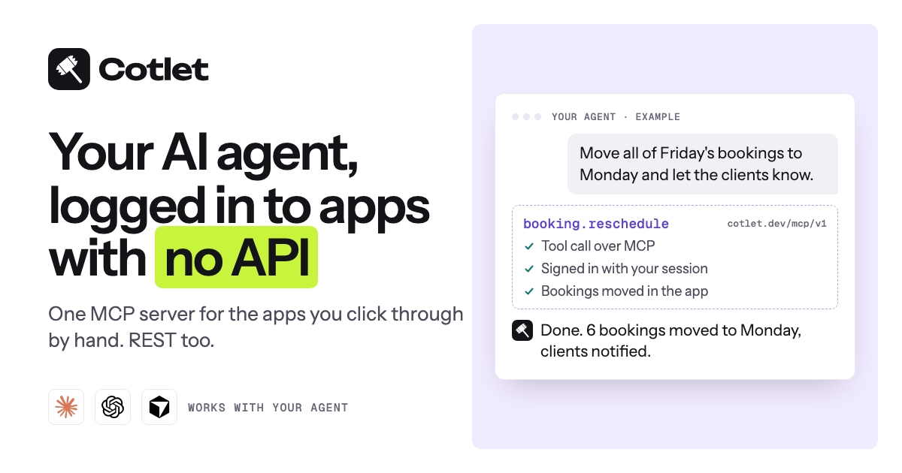

<div align="center">

<a href="https://cotlet.dev">
  <picture>
    <source media="(prefers-color-scheme: dark)" srcset="assets/logo-white.svg">
    
  </picture>
</a>

### Your AI agent, logged in to the apps that never built an API.

One hosted MCP server for all your apps. A REST API too.

[Website](https://cotlet.dev) ·
[Integrations](https://cotlet.dev/integrations) ·
[Docs](https://cotlet.dev/docs) ·
[MCP server](https://cotlet.dev/docs/mcp) ·
[REST API](https://cotlet.dev/docs/api) ·
[Pricing](https://cotlet.dev/pricing) ·
[Security](https://cotlet.dev/security) ·
[Request access](https://cotlet.dev/signup) ·
[X](https://x.com/cotletdev)

[](https://cotlet.dev)
[](https://cotlet.dev/docs/mcp)
[](https://cotlet.dev/docs/api)
[](https://cotlet.dev/integrations)
[](https://cotlet.dev/llms.txt)
[](https://x.com/cotletdev)



</div>

---

## What is Cotlet?

**Cotlet** is a catalog of hosted integrations for web apps that have **no official API**, or only a narrow one. Each integration is exposed two ways:

- as tools in **one remote MCP server** (`https://cotlet.dev/mcp/v1`) for AI agents such as Claude, ChatGPT, Cursor, Codex, GitHub Copilot, Gemini, Windsurf and n8n;
- as a **REST API** (`https://cotlet.dev/api/v1`) for your own scripts and cron jobs.

You sign in to each app **yourself, once**, in your browser. Cotlet keeps only the session, never your password. From then on your agent works **in your own account**, as you, and does the clicking for you: it moves bookings, sends invoices, approves members, pulls reports, relists items.

> **In one sentence:** Cotlet lets your AI agent sign in to the apps you click through by hand and do the work over MCP, without waiting for the vendor to ship an API.

| | |
|---|---|
| **Product** | Hosted MCP servers and REST APIs for apps with no usable API |
| **Website** | [cotlet.dev](https://cotlet.dev) |
| **MCP endpoint** | `https://cotlet.dev/mcp/v1` |
| **REST base URL** | `https://cotlet.dev/api/v1` |
| **For** | People and small teams who work with AI agents: creators, community owners, course sellers, agencies, local service businesses, real estate pros, freelancers, developers |
| **Works with** | Claude Code, Claude Desktop, ChatGPT, Cursor, Codex, GitHub Copilot, Gemini, Windsurf, n8n and any MCP client |
| **Catalog** | 97 apps in 6 categories ([full list](docs/integrations.md)), 526 documented use cases ([list](docs/use-cases.md)) |
| **Pricing** | Free 7-day trial with 5,000 credits, then one plan from $29/month ([details](docs/pricing.md)) |
| **Market** | Worldwide, English |
| **Company** | Take Group sp. z o.o., Katowice, Poland (EU) |
| **Contact** | [contact@cotlet.dev](mailto:contact@cotlet.dev) |
| **X** | [@cotletdev](https://x.com/cotletdev) |

## The problem

You asked your agent to do something. **It hit a login page.**

- *"Send this month's invoice."* No API for this app.
- *"Move Friday's bookings to Monday."* No API for this app.
- *"Pull the weekly report from the CRM."* No API for this app.

So you clicked through it yourself. Again.

AI agents are good at doing work, but they can only reach tools that expose an API or an MCP server. Most of the software that small businesses and creators live in every day does not: community platforms, booking systems, course platforms, marketplaces, property portals, field-service and invoicing tools. When an API exists at all, it is often:

- **missing**: no public API, no developer docs, no keys;
- **limited**: read-only, or missing the endpoints people actually need (DMs, drafts, coupons, reports);
- **gated**: partners only, after an application, a contract or a review;
- **paid**: locked behind a top plan or a separate add-on.

Of the 97 apps in the Cotlet catalog today, **26 have no official API at all**, **31 have a limited one**, **28 are partners-only** and **12 sell API access as a paid add-on**. Read more in [docs/problem.md](docs/problem.md).

## The solution

Cotlet builds and maintains the missing access, then hands it to your agent as ordinary tools.

```text
 You          ──sign in once──▶  App (Skool, Booksy, Substack, ...)
                                   ▲
 Your agent ──MCP / REST──▶ Cotlet ┘  works in your account with your saved session
```

1. **Pick your apps** from the [catalog](https://cotlet.dev/integrations), or request one that is missing.
2. **Sign in once** to each app yourself, on the Cotlet connect page. Only the session is kept, encrypted.
3. **Add Cotlet to your agent** with one MCP URL. Every app you connect shows up as tools.
4. **Let the agent do it**, on request or on a schedule. The chore is gone.

Full walkthrough: [docs/how-it-works.md](docs/how-it-works.md).

## Quick start

### Connect your agent over MCP

```bash
claude mcp add --transport http cotlet https://cotlet.dev/mcp/v1 \
  --header "Authorization: Bearer $COTLET_API_KEY"
```

<details>
<summary>Cursor, Codex, Claude Desktop, ChatGPT, n8n</summary>

**Cursor** (`~/.cursor/mcp.json`)

```json
{
  "mcpServers": {
    "cotlet": {
      "url": "https://cotlet.dev/mcp/v1",
      "headers": { "Authorization": "Bearer ${env:COTLET_API_KEY}" }
    }
  }
}
```

**Codex** (`~/.codex/config.toml`)

```toml
[mcp_servers.cotlet]
url = "https://cotlet.dev/mcp/v1"
bearer_token_env_var = "COTLET_API_KEY"
```

**Claude Desktop**: Settings > Connectors > Add custom connector, name `Cotlet`, URL `https://cotlet.dev/mcp/v1`.

**ChatGPT**: Settings > Apps & Connectors > Create, MCP server URL `https://cotlet.dev/mcp/v1`, authentication OAuth.

**n8n**: node *MCP Client Tool*, endpoint `https://cotlet.dev/mcp/v1`, Header Auth `Authorization: Bearer <your key>`.

</details>

Then just ask:

> *"Approve all pending membership requests in my Skool community and welcome them in a post."*

Your agent calls `skool_list_members`, `skool_approve_membership_request` and `skool_create_post`, signed in as you. Setup details: [docs/mcp-server.md](docs/mcp-server.md).

### Or call it from a script

```bash
curl -X POST https://cotlet.dev/api/v1/skool/list_members \
  -H "Authorization: Bearer $COTLET_API_KEY" \
  -H "Content-Type: application/json" \
  -d '{"group": "yourgroup", "role": "admin"}'
```

Same key, same inputs, same outputs as MCP. Reference: [docs/rest-api.md](docs/rest-api.md).

## Integrations

97 apps in 6 categories. Each one has its own page on cotlet.dev with the official API status, sources, and every tool with its parameters.

| Category | Apps | Examples |
|---|---|---|
| Creators & communities | 19 | [Skool](https://cotlet.dev/integrations/skool-api-mcp-server), [Substack](https://cotlet.dev/integrations/substack-api-mcp-server), [Medium](https://cotlet.dev/integrations/medium-api-mcp-server), [Meetup](https://cotlet.dev/integrations/meetup-api-mcp-server), [Patreon](https://cotlet.dev/integrations/patreon-api-mcp-server), [Partiful](https://cotlet.dev/integrations/partiful-api-mcp-server) |
| Courses & training | 10 | [Udemy](https://cotlet.dev/integrations/udemy-api-mcp-server), [Teachable](https://cotlet.dev/integrations/teachable-api-mcp-server), [ThriveCart](https://cotlet.dev/integrations/thrivecart-api-mcp-server), [Payhip](https://cotlet.dev/integrations/payhip-api-mcp-server), [Uscreen](https://cotlet.dev/integrations/uscreen-api-mcp-server) |
| Travel | 13 | [GetYourGuide](https://cotlet.dev/integrations/getyourguide-api-mcp-server), [Klook](https://cotlet.dev/integrations/klook-api-mcp-server), [Hostelworld](https://cotlet.dev/integrations/hostelworld-api-mcp-server), [Wanderlog](https://cotlet.dev/integrations/wanderlog-api-mcp-server), [Hipcamp](https://cotlet.dev/integrations/hipcamp-api-mcp-server) |
| Real estate | 13 | [Idealista](https://cotlet.dev/integrations/idealista-api-mcp-server), [Zoopla](https://cotlet.dev/integrations/zoopla-api-mcp-server), [Crexi](https://cotlet.dev/integrations/crexi-api-mcp-server), [DoorLoop](https://cotlet.dev/integrations/doorloop-api-mcp-server), [Rent Manager](https://cotlet.dev/integrations/rent-manager-api-mcp-server) |
| Local services & SaaS | 35 | [Booksy](https://cotlet.dev/integrations/booksy-api-mcp-server), [Fresha](https://cotlet.dev/integrations/fresha-api-mcp-server), [Vagaro](https://cotlet.dev/integrations/vagaro-api-mcp-server), [Faire](https://cotlet.dev/integrations/faire-api-mcp-server), [Pirate Ship](https://cotlet.dev/integrations/pirate-ship-api-mcp-server), [Workiz](https://cotlet.dev/integrations/workiz-api-mcp-server) |
| Invoicing & freelance CRM | 7 | [Dubsado](https://cotlet.dev/integrations/dubsado-api-mcp-server), [Joist](https://cotlet.dev/integrations/joist-api-mcp-server), [Tradify](https://cotlet.dev/integrations/tradify-api-mcp-server), [SuiteDash](https://cotlet.dev/integrations/suitedash-api-mcp-server), [PeoplePerHour](https://cotlet.dev/integrations/peopleperhour-api-mcp-server) |

**Full catalog with every app, its official API status and its tools: [docs/integrations.md](docs/integrations.md).**

Ready-made Python scripts per app: [Skool API and MCP server](https://github.com/cotletdev/skool-api-mcp-server) (export members, approve membership requests, posts, DMs, stats), [Substack API and MCP server](https://github.com/cotletdev/substack-api-mcp-server) (schedule posts and Notes from Markdown, export subscribers and posts, comments, stats).

Missing an app? [Request it on cotlet.dev](https://cotlet.dev/integrations#catalog-search), no account needed. If enough people ask, we add it.

## Security and trust

Your login stays yours. The model never sees it.

- **No stored passwords.** You sign in to each app yourself. Cotlet keeps only the session, encrypted with AES-256-GCM, the same cipher 1Password uses for its vaults.
- **One isolated session per user and app**, never shared between users.
- **The AI model never sees a login.** Agents call tools, not sessions.
- **No payload retention.** Data passes through a call to your agent and is not kept.
- **Scoped consent.** You choose what each app allows: read only, read and edit, or full with your confirmation on every send. Actions that reach other people wait for your OK by default.
- **Revoke in one click.** Disconnect an app and its session is deleted at once.
- **What we never do:** break CAPTCHAs, bypass MFA, automate banks without a licence, touch LinkedIn or Instagram, keep going after a cease-and-desist, or store your data longer than the call.
- **Checked by independent scanners:** A+ on [Qualys SSL Labs](https://www.ssllabs.com/ssltest/analyze.html?d=cotlet.dev), [securityheaders.com](https://securityheaders.com/?q=cotlet.dev&followRedirects=on) and [Mozilla Observatory](https://developer.mozilla.org/en-US/observatory/analyze?host=cotlet.dev).
- **Hosted in the EU:** the console, API, database and session vault run in a data centre in Finland.

More: [docs/security.md](docs/security.md) and [cotlet.dev/security](https://cotlet.dev/security).

## Pricing

Pay like you pay for an API: one plan in three sizes, billed in credits that stay valid for 3 months.

| Plan | Price | Credits per month | Best for |
|---|---|---|---|
| **Free trial** | $0 for 7 days | 5,000 | Trying Cotlet, no card needed |
| **Solo** | $29/month | 3,000 | One agent, a few tasks a day |
| **Pro** | $99/month | 12,000 | Daily agent work across your tools |
| **Agency** | $299/month | 40,000 | Agencies and teams with many apps |

Every size includes every app, one MCP server and REST API key, credits valid for 3 months and a hard spend cap. Only successful calls use credits. Nothing is charged until your access is active. Details: [docs/pricing.md](docs/pricing.md).

## Why not a script from GitHub?

Scripts break when the app changes, and you fix them yourself. Cotlet tests every integration daily, pauses calls when a site changes, ships the fix and refunds credits for failed calls. You get a stable tool name and schema; how Cotlet reaches each app is our job. Comparison: [docs/comparison.md](docs/comparison.md).

## Documentation in this repository

| File | What is inside |
|---|---|
| [docs/what-is-cotlet.md](docs/what-is-cotlet.md) | Definition, positioning, key facts |
| [docs/problem.md](docs/problem.md) | Why agents stop at the login page and what "no API" really means |
| [docs/how-it-works.md](docs/how-it-works.md) | The four steps, sessions, confirmations, what happens when a site changes |
| [docs/mcp-server.md](docs/mcp-server.md) | MCP server setup for every client, tool naming, errors |
| [docs/rest-api.md](docs/rest-api.md) | REST API: auth, calls, pagination, confirmation, error codes |
| [docs/integrations.md](docs/integrations.md) | All 97 apps with official API status and tools |
| [docs/use-cases.md](docs/use-cases.md) | 526 jobs people hand to their agent, app by app |
| [docs/security.md](docs/security.md) | How access is held, consent, what we never do |
| [docs/pricing.md](docs/pricing.md) | Trial, plans, credits |
| [docs/comparison.md](docs/comparison.md) | Cotlet vs DIY scripts, RPA, browser agents and official APIs |
| [docs/faq.md](docs/faq.md) | Frequently asked questions |
| [docs/glossary.md](docs/glossary.md) | MCP, credits, session, connect page and other terms |
| [docs/brand.md](docs/brand.md) | Name, logo, colors, how to write about Cotlet |
| [docs/for-ai-agents.md](docs/for-ai-agents.md) | Facts and endpoints for AI agents and LLM crawlers |

## Links

- Website: [cotlet.dev](https://cotlet.dev)
- Integrations: [cotlet.dev/integrations](https://cotlet.dev/integrations)
- Use cases: [cotlet.dev/use-cases](https://cotlet.dev/use-cases)
- How it works: [cotlet.dev/how-it-works](https://cotlet.dev/how-it-works)
- Docs: [cotlet.dev/docs](https://cotlet.dev/docs) (Markdown: [cotlet.dev/docs.md](https://cotlet.dev/docs.md))
- For AI agents: [cotlet.dev/llms.txt](https://cotlet.dev/llms.txt)
- Pricing: [cotlet.dev/pricing](https://cotlet.dev/pricing)
- Security: [cotlet.dev/security](https://cotlet.dev/security)
- For developers: [cotlet.dev/for-developers](https://cotlet.dev/for-developers)
- For agencies: [cotlet.dev/for-agencies](https://cotlet.dev/for-agencies)
- Blog: [cotlet.dev/blog](https://cotlet.dev/blog)
- Changelog: [cotlet.dev/changelog](https://cotlet.dev/changelog)
- About: [cotlet.dev/about](https://cotlet.dev/about)
- Contact: [cotlet.dev/contact](https://cotlet.dev/contact) · [contact@cotlet.dev](mailto:contact@cotlet.dev)
- GitHub: [github.com/cotletdev](https://github.com/cotletdev)
- X: [@cotletdev](https://x.com/cotletdev)
- Skool API and MCP server: [github.com/cotletdev/skool-api-mcp-server](https://github.com/cotletdev/skool-api-mcp-server)
- Substack API and MCP server: [github.com/cotletdev/substack-api-mcp-server](https://github.com/cotletdev/substack-api-mcp-server)

## About

Cotlet is built in Europe for people who work with AI agents, worldwide. It is run by **Take Group sp. z o.o.**, ul. Wincentego Janasa 4, 40-855 Katowice, Poland (KRS 0000871398, NIP 6342984273).

Cotlet is independent. Product names in the catalog are trademarks of their owners; Cotlet is unofficial and not affiliated with, or endorsed by, any app it integrates with. You use your own account and stay responsible for following each app's terms.

<div align="center">

**[Request access at cotlet.dev](https://cotlet.dev/signup)**

<sub>Stop clicking through it. Let your agent do it.</sub>

</div>
